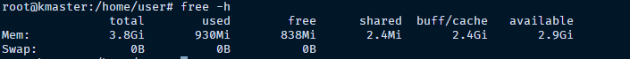
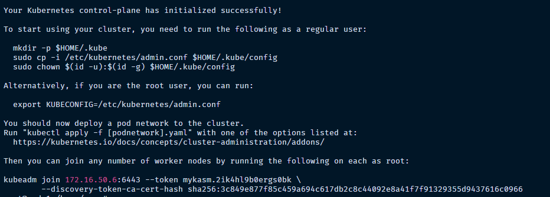
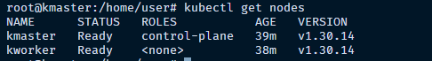

# Documentation – Kubernetes (K8s) Installation on 2 Nodes

This document describes step by step how to install a 2-node Kubernetes cluster (1 Master + 1 Worker) on Ubuntu Server 24.04, using kubeadm, containerd, and the Flannel network plugin.

## 1.Target Architecture


| Rôle     | Hostname | Adresse IP  | OS               |
| -------- | -------- | ----------- |----------------- |
| Master   | kmaster  | 172.16.50.6 | Ubuntu 24.04 LTS |
| Worker   | kworker  | 172.16.50.7 | Ubuntu 24.04 LTS |

## 2. Prerequisites

* Two machines (VMs or physical servers) with Ubuntu 24.04 installed
* Static IP addresses configured
* Unique hostnames
* SSH access
* User with sudo privileges
* Internet access


## 3. Phase 1 – Preparation (Run on BOTH nodes)
### 3.1 System update and hostname configuration
```
sudo apt update && sudo apt upgrade -y
```
On the **Master** node:
```
sudo hostnamectl set-hostname kmaster
```
On the **Worker** node:
```
sudo hostnamectl set-hostname kworker
```


### 3.2 Disable swap

Kubernetes requires swap to be disabled.

```
sudo swapoff -a
sudo sed -i '/ swap / s/^\(.*\)$/#\1/g' /etc/fstab
```
Verification: 

```
free -h
```



### 3.3 Load kernel modules and configure networking
Load required kernel modules
```
cat <<EOF | sudo tee /etc/modules-load.d/k8s.conf
overlay
br_netfilter
EOF

sudo modprobe overlay
sudo modprobe br_netfilter
```

Configure network parameters
```
cat <<EOF | sudo tee /etc/sysctl.d/k8s.conf
net.bridge.bridge-nf-call-iptables  = 1
net.bridge.bridge-nf-call-ip6tables = 1
net.ipv4.ip_forward                 = 1
EOF

sudo sysctl --system
```

### 3.4 Install containerd

```
sudo apt install -y containerd
sudo mkdir -p /etc/containerd
containerd config default | sudo tee /etc/containerd/config.toml >/dev/null
```

Enable systemd cgroup driver (recommended by Kubernetes):

```
sudo sed -i 's/SystemdCgroup = false/SystemdCgroup = true/g' /etc/containerd/config.toml
sudo systemctl restart containerd
```

### 3.5 Install kubeadm, kubelet, and kubectl

Install dependencies

```
sudo apt install -y apt-transport-https ca-certificates curl gpg
sudo mkdir -p -m 755 /etc/apt/keyrings
```
Add Kubernetes repository (v1.30)
```
curl -fsSL https://pkgs.k8s.io/core:/stable:/v1.30/deb/Release.key | sudo gpg --dearmor -o /etc/apt/keyrings/kubernetes-apt-keyring.gpg

echo 'deb [signed-by=/etc/apt/keyrings/kubernetes-apt-keyring.gpg] https://pkgs.k8s.io/core:/stable:/v1.30/deb/ /' | sudo tee /etc/apt/sources.list.d/kubernetes.list
```
Install Kubernetes components
```
sudo apt update
sudo apt install -y kubelet kubeadm kubectl
sudo apt-mark hold kubelet kubeadm kubectl
```

## 4. Phase 2 – Initialize the Master Node
Run only on the Master node (kmaster)
### 4.1 Initialize the cluster

```
sudo kubeadm init --pod-network-cidr=10.244.0.0/16 --apiserver-advertise-address=172.16.50.6 
```



At the end of the command, save the kubeadm join command, it will be required on the Worker node.

### 4.2 Configure kubectl for the current user

```
mkdir -p $HOME/.kube
sudo cp -i /etc/kubernetes/admin.conf $HOME/.kube/config
sudo chown $(id -u):$(id -g) $HOME/.kube/config
```


### 4.3 Install the network plugin (Flannel)
```
kubectl apply -f https://github.com/flannel-io/flannel/releases/latest/download/kube-flannel.yml
```

## 5. Phase 3 – Join the Worker Node to the Cluster
Run only on the Worker node (kworker)
Use the command generated during Master initialization:
```
kubeadm join 172.16.50.6:6443 --token mykasm.2ik4hl9b0ergs0bk \
        --discovery-token-ca-cert-hash sha256:3c849e877f85c459a694c617db2c8c44092e8a41f7f91329355d9437616c0966 
```

## 6. Phase 4 – Cluster Verification

On the Master node

```
kubectl get nodes
```


## 7 . Quick Troubleshooting
Check system pods status
```
kubectl get pods -n kube-system
```
Check services
```
systemctl status kubelet
systemctl status containerd
```